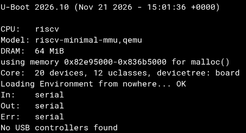

# RISC-V-emulator-u-boot

U-Boot build wrapper for the [RISC-V emulator](../RISC-V-emulator-Native). The wrapper pins U-Boot `v2026.10` in the shared cache and builds the `qemu-riscv32_smode` target in a container.

## Layout

- `$XDG_CACHE_HOME/riscv-emulator/u-boot-v2026.10` - pinned U-Boot source at commit `5508406582f6f7120dce0c4b3059819a41788db2`, outside both repositories.
- `configs/uboot-fragment.config` - Kconfig fragment merged after the defconfig.
- `configs/riscv-emulator.env` - compiled-in default environment, read through the container bind mount.
- `Makefile` - `fetch`, `defconfig`, `build`, `clean`, `distclean` and `purge-cache` targets.
- `build/` - out-of-tree U-Boot build output (gitignored).

## Dependencies

The build image is `riscv-emulator-tools-container`. It provides the xPack `riscv-none-elf-gcc` bare-metal toolchain, the U-Boot host tools and `riscv64-linux-gnu-ld`. U-Boot compiles with the xPack compiler and links with the Linux linker, because the xPack linker has no `-pie` or `-shared` support. The tool split is in [`docs/dependencies.md`](docs/dependencies.md).

## Build

```sh
make fetch     # clone the pinned U-Boot tag into the cache
make defconfig # qemu-riscv32_smode_defconfig plus the fragment
make build     # build u-boot.bin in build/
```

The cached source is mounted into the container at `/u-boot-src` and this wrapper at `/src`. The build is out-of-tree (`O=/src/build`), so the cached source stays clean. The environment file is read from `/src/configs/riscv-emulator.env`; nothing is copied into the source tree. Override `XDG_CACHE_HOME` to move the cache. `make distclean` removes the build output; `make purge-cache` removes the cached source.

## Output

`build/u-boot.bin` is the raw binary. The emulator loads OpenSBI at `0x80000000` and U-Boot at `0x80400000`, the `qemu-riscv32_smode` default for RV32 S-mode and the OpenSBI `FW_JUMP_OFFSET=0x400000` target.

## License

Apache-2.0. U-Boot is GPL-2.0-or-later and keeps its own license in the cached source.
